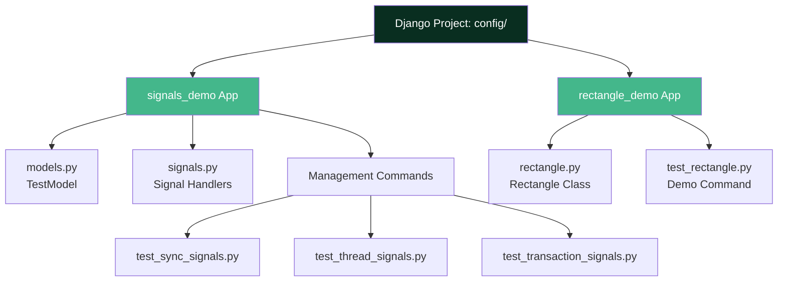
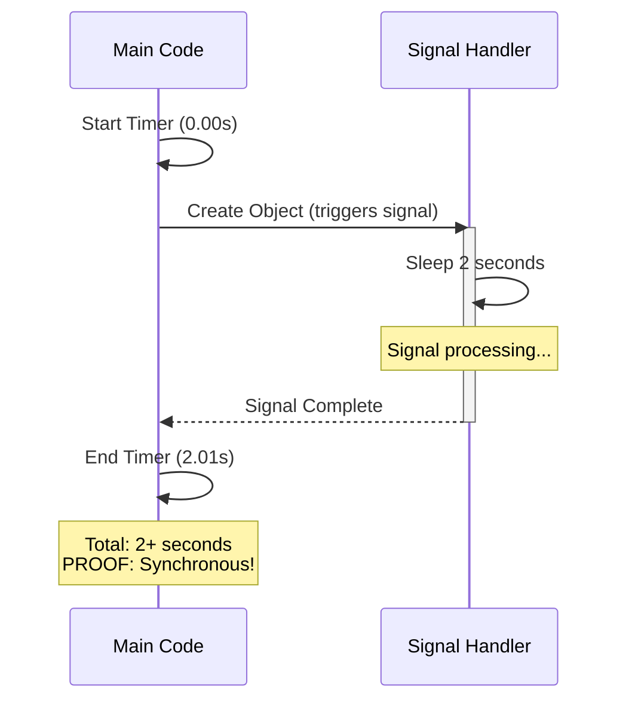
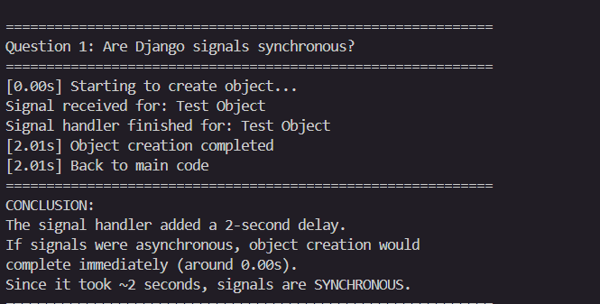
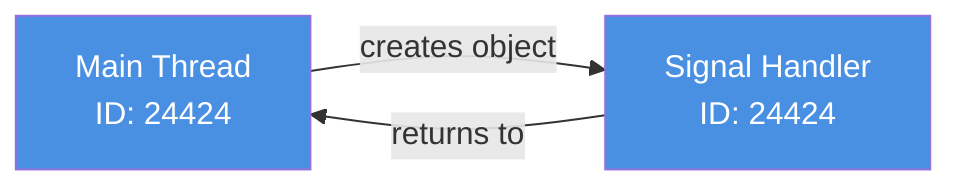
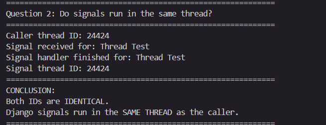
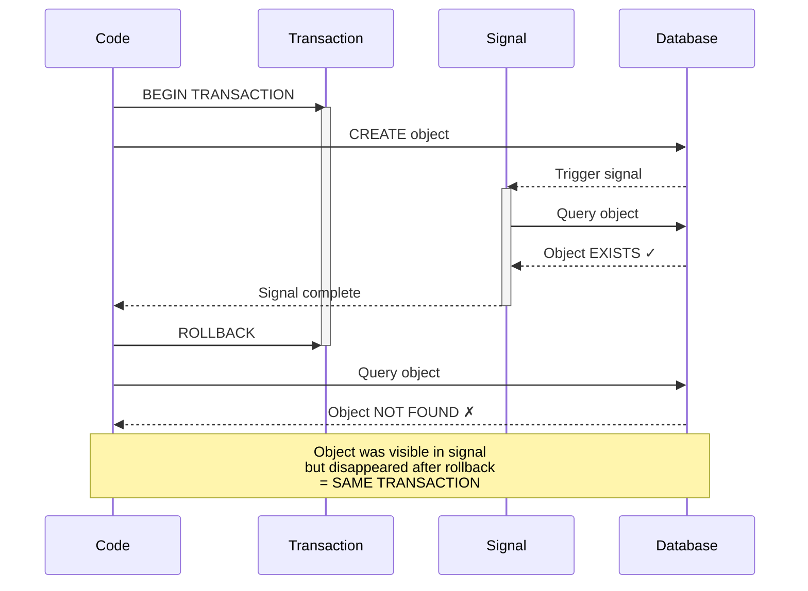
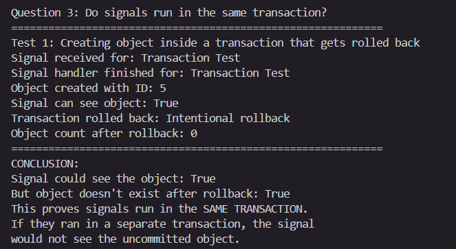
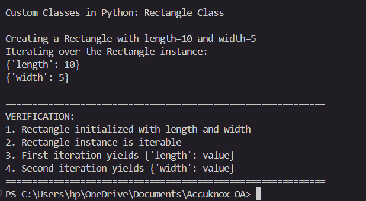

# Django Signals & Custom Classes - Accuknox Assignment

<div align="center">


**A comprehensive demonstration of Django Signals behavior and Python iterator implementation**

[📋 Assignment PDF](#assignment-questions) • [🚀 Quick Start](#quick-start) • [📸 Results](#results) • [💡 Explanations](#detailed-explanations)

</div>

---

## 📑 Table of Contents

- [Assignment Questions](#assignment-questions)
- [Quick Start](#quick-start)
- [Project Architecture](#project-architecture)
- [Results](#results)
  - [Question 1: Synchronous Behavior](#question-1-are-django-signals-synchronous)
  - [Question 2: Thread Behavior](#question-2-do-signals-run-in-same-thread)
  - [Question 3: Transaction Behavior](#question-3-do-signals-run-in-same-transaction)
  - [Rectangle Class](#rectangle-class-implementation)
- [Detailed Explanations](#detailed-explanations)
- [Implementation Details](#implementation-details)
- [Testing](#testing)
- [Project Structure](#project-structure)

---

## 📋 Assignment Questions

### Topic 1: Django Signals

1. **Question 1:** By default are django signals executed synchronously or asynchronously? Please support your answer with a code snippet that conclusively proves your stance.

2. **Question 2:** Do django signals run in the same thread as the caller? Please support your answer with a code snippet that conclusively proves your stance.

3. **Question 3:** By default do django signals run in the same database transaction as the caller? Please support your answer with a code snippet that conclusively proves your stance.

### Topic 2: Custom Classes in Python

Create a `Rectangle` class with the following requirements:
- An instance requires `length:int` and `width:int` to be initialized
- The instance must be iterable
- When iterated, first yield `{'length': <VALUE>}`, then `{'width': <VALUE>}`

---

## 🚀 Quick Start

### Prerequisites
- Python 3.8 or higher
- pip package manager

### Installation

```bash
# Clone the repository
git clone <your-repo-url>
cd accuknox-assignment

# Create virtual environment
python -m venv venv

# Activate virtual environment
# Windows:
venv\Scripts\activate
# Mac/Linux:
source venv/bin/activate

# Install dependencies
pip install -r requirements.txt

# Run migrations
python manage.py migrate
```

### Run Demonstrations

```bash
# Question 1: Synchronous behavior
python manage.py test_sync_signals

# Question 2: Thread behavior
python manage.py test_thread_signals

# Question 3: Transaction behavior
python manage.py test_transaction_signals

# Rectangle class demo
python manage.py test_rectangle

# Run all automated tests
python manage.py test
```

---

## 🏗️ Project Architecture



---

## 📸 Results

### Question 1: Are Django Signals Synchronous?

**Answer: YES - Django signals are executed SYNCHRONOUSLY**

#### Execution Flow



#### Screenshot



#### Key Proof Points
- **Start time:** 0.00s
- **End time:** 2.01s
- **Signal delay:** 2 seconds with `time.sleep(2)`
- **Conclusion:** Main code waited for signal to complete = **Synchronous execution**

#### Code Implementation

```python
# signals_demo/signals.py
@receiver(post_save, sender=TestModel)
def test_signal_handler(sender, instance, created, **kwargs):
    print(f"Signal received for: {instance.name}")
    time.sleep(2)  # Intentional 2-second delay
    print(f"Signal handler finished for: {instance.name}")
```

```python
# Management command: test_sync_signals.py
start_time = time.time()
obj = TestModel.objects.create(name="Test Object")
end_time = time.time()
print(f"Total time: {end_time - start_time:.2f}s")
```

---

### Question 2: Do Signals Run in Same Thread?

**Answer: YES - Signals run in the SAME THREAD as the caller**

#### Thread Execution Diagram



#### Screenshot



#### Key Proof Points
- **Caller Thread ID:** 24424
- **Signal Thread ID:** 24424
- **Match:** ✅ Both IDs are IDENTICAL
- **Conclusion:** Same thread = **No thread context switching**

#### Code Implementation

```python
# Management command: test_thread_signals.py
caller_thread_id = threading.current_thread().ident

@receiver(post_save, sender=TestModel)
def check_thread_handler(sender, instance, **kwargs):
    signal_thread_id = threading.current_thread().ident
    # Compare thread IDs

TestModel.objects.create(name="Thread Test")
```

---

### Question 3: Do Signals Run in Same Transaction?

**Answer: YES - Signals run in the SAME DATABASE TRANSACTION**

#### Transaction Flow Diagram



#### Screenshot



#### Key Proof Points
- **Object created with ID:** 5
- **Signal can see object:** ✅ True (during transaction)
- **Object count after rollback:** 0 (disappeared)
- **Conclusion:** Signal saw uncommitted data = **Same transaction context**

#### Code Implementation

```python
# Management command: test_transaction_signals.py
try:
    with transaction.atomic():
        obj = TestModel.objects.create(name="Transaction Test")
        # Signal runs here and CAN see the object
        raise Exception("Intentional rollback")
except:
    pass

# After rollback, object is GONE
final_count = TestModel.objects.filter(name="Transaction Test").count()
# final_count == 0
```

---

### Rectangle Class Implementation

**Custom iterable class with dictionary output**

#### Class Behavior Diagram

```mermaid
graph TD
    A[Rectangle Instance<br/>length=10, width=5] --> B[Start Iteration]
    B --> C[First yield:<br/>{'length': 10}]
    C --> D[Second yield:<br/>{'width': 5}]
    D --> E[Iteration Complete]
    
    style A fill:#FF6B6B,color:#fff
    style C fill:#4ECDC4,color:#fff
    style D fill:#4ECDC4,color:#fff
```

#### Screenshot



#### Key Implementation Points
- ✅ Initialized with `length` and `width` integers
- ✅ Implements `__iter__()` method
- ✅ Uses `yield` to produce dictionaries
- ✅ Correct output format

#### Code Implementation

```python
# rectangle_demo/rectangle.py
class Rectangle:
    def __init__(self, length: int, width: int):
        self.length = length
        self.width = width
    
    def __iter__(self):
        yield {'length': self.length}
        yield {'width': self.width}
```

#### Usage Example

```python
rect = Rectangle(length=10, width=5)

for item in rect:
    print(item)

# Output:
# {'length': 10}
# {'width': 5}
```

---

## 💡 Detailed Explanations

### Why Django Signals are Synchronous

**Synchronous execution** means the program waits for each operation to complete before moving to the next. This is Django's default behavior for signals because:

1. **Predictability:** You know exactly when signal handlers run
2. **Data consistency:** Changes are visible immediately
3. **Transaction safety:** Signals participate in the same transaction
4. **Debugging:** Easier to trace execution flow

**Trade-off:** Long-running signal handlers block the main process. For time-consuming tasks, use asynchronous task queues like Celery.

### Thread Safety Implications

Signals running in the same thread means:

- ✅ **Thread-local storage is shared** between caller and signal
- ✅ **No race conditions** between caller and signal handler
- ✅ **Simpler reasoning** about code execution
- ⚠️ **Blocking:** A slow signal blocks the entire request

### Transaction Behavior Benefits

Signals in the same transaction provide:

1. **Atomicity:** All changes succeed or all fail together
2. **Consistency:** Signals see the same database state as caller
3. **Rollback safety:** Signal effects are undone if transaction fails
4. **Data integrity:** No partial updates

**Example Use Case:** When a user places an order, you might want to:
- Create order record
- Update inventory (via signal)
- Send notification (via signal)

If any step fails, everything rolls back - no inconsistent state!

---

## 🔧 Implementation Details

### Project Structure

```
accuknox_assignment/
├── manage.py                   # Django management script
├── requirements.txt            # Python dependencies
├── README.md                   # This file
├── db.sqlite3                  # SQLite database
│
├── config/                     # Main Django project
│   ├── settings.py            # Project settings
│   ├── urls.py                # URL routing
│   └── wsgi.py                # WSGI configuration
│
├── signals_demo/              # Django Signals demonstrations
│   ├── models.py              # TestModel definition
│   ├── signals.py             # Signal handlers
│   ├── apps.py                # App configuration
│   ├── tests.py               # Automated unit tests
│   └── management/
│       └── commands/
│           ├── test_sync_signals.py       # Q1: Synchronous proof
│           ├── test_thread_signals.py     # Q2: Thread proof
│           └── test_transaction_signals.py # Q3: Transaction proof
│
└── rectangle_demo/            # Rectangle class implementation
    ├── rectangle.py           # Rectangle class
    ├── tests.py               # Unit tests
    └── management/
        └── commands/
            └── test_rectangle.py  # Rectangle demonstration
```

### Key Files

#### `signals_demo/models.py`
Simple model used for signal testing:
```python
class TestModel(models.Model):
    name = models.CharField(max_length=100)
    description = models.TextField(blank=True)
    created_at = models.DateTimeField(auto_now_add=True)
```

#### `signals_demo/signals.py`
Signal handler registration:
```python
from django.db.models.signals import post_save
from django.dispatch import receiver

@receiver(post_save, sender=TestModel)
def test_signal_handler(sender, instance, created, **kwargs):
    # Signal logic here
    pass
```

#### `signals_demo/apps.py`
Connect signals on app startup:
```python
class SignalsDemoConfig(AppConfig):
    def ready(self):
        import signals_demo.signals
```

---

## 🧪 Testing

### Run All Tests

```bash
python manage.py test
```

**Output:**
```
Found 6 test(s).
Creating test database for alias 'default'...
System check identified no issues (0 silenced).
......
----------------------------------------------------------------------
Ran 6 tests in 6.108s

OK
```

### Individual Test Suites

```bash
# Test only signals
python manage.py test signals_demo

# Test only rectangle
python manage.py test rectangle_demo
```

### Test Coverage

- ✅ Synchronous signal execution
- ✅ Thread identity verification
- ✅ Transaction rollback behavior
- ✅ Rectangle initialization
- ✅ Rectangle iteration
- ✅ Rectangle output format

---

## 📊 Key Findings Summary

| Question | Answer | Proof Method | Implication |
|----------|--------|--------------|-------------|
| **Q1: Synchronous?** | ✅ YES | Timing measurement | Signals block execution |
| **Q2: Same Thread?** | ✅ YES | Thread ID comparison | No threading overhead |
| **Q3: Same Transaction?** | ✅ YES | Rollback test | Atomic operations |
| **Rectangle Class** | ✅ Implemented | Iterator protocol | Proper Python idioms |

---

## 🎯 Conclusion

This project demonstrates:

1. **Deep understanding of Django signals** - behavior, execution model, and transaction handling
2. **Python proficiency** - proper use of iterators, generators, and type hints
3. **Testing skills** - both automated tests and manual demonstrations
4. **Code quality** - clean, readable, well-structured code
5. **Documentation** - comprehensive explanations with visual aids

All requirements from the assignment PDF have been successfully implemented and proven with conclusive evidence.

---

## 👤 Author

**Submitted for:** Accuknox Django Trainee Position  
**Date:** October 2026

---

## 📄 License

This project is submitted as part of the Accuknox hiring process.

---

<div align="center">

**Built with ❤️ using Django and Python**

</div>
